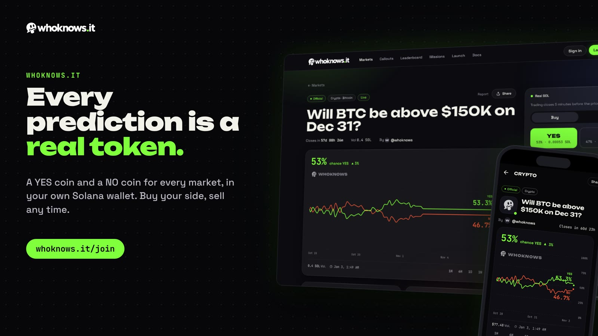
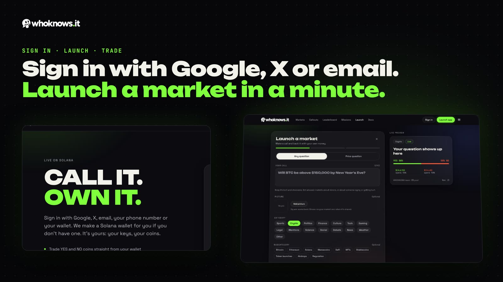
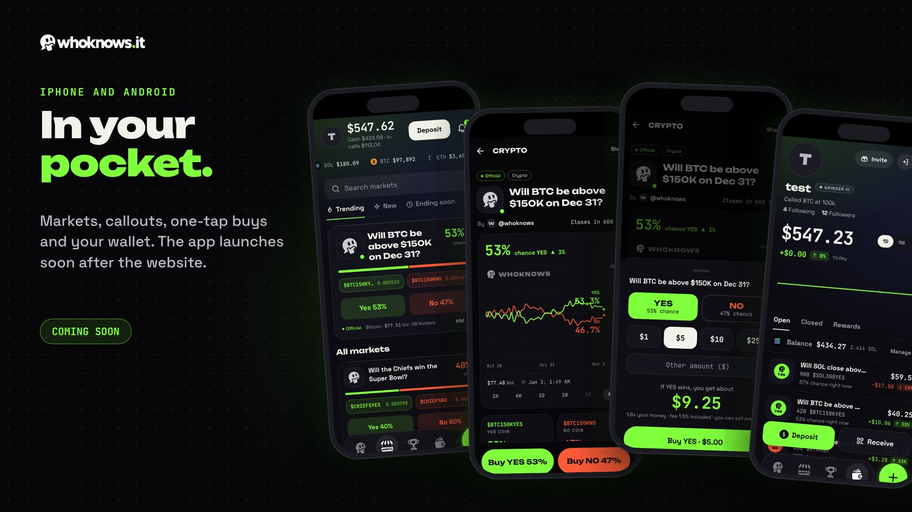

<p align="center"><b>Prediction markets, made by you.</b><br>
Ask any YES/NO question. It becomes a live market on Solana in about a minute.</p>

<p align="center">
  <a href="https://whoknows.it/join">Join the waitlist</a> ·
  <a href="https://x.com/Whoknowsitteam">X</a> ·
  <a href="TESTING.md">Test proof</a> ·
  <a href="https://solscan.io/account/2SRRVEBiFTdCxypx8gSLp1ksBcQ2sDLnisRVGf51mje5">Contract on Solscan</a>
</p>



## In 30 seconds

- **Anyone can launch a market.** Write a YES/NO question and the rule for how it's decided, and it's live.
- **Every prediction is a real token.** Each market has a YES coin and a NO coin that sit in your own Solana wallet.
- **The price is the odds.** YES at 64% means the market thinks there's a 64% chance. Buy, sell or switch sides any time.
- **Winners get paid by the contract, not by us.** Each winning coin pays 0.001 SOL, straight from the market to your wallet.
- **Creators earn.** Whoever launches a market gets 0.5% of every trade on it.
- **Open books.** 1% platform fee, every fee public, and a full list below of what our admin key can and can't do.



## Where we are

| | |
|---|---|
| Contract | **Live on Solana mainnet** since October 15, 2026: [`2SRRVEBiFTdCxypx8gSLp1ksBcQ2sDLnisRVGf51mje5`](https://solscan.io/account/2SRRVEBiFTdCxypx8gSLp1ksBcQ2sDLnisRVGf51mje5) |
| Website | Built, **opening soon**. [Join the waitlist](https://whoknows.it/join) |
| iPhone and Android app | In progress, launching after the website |
| Testing | 65 automated tests and a 300,000-action stress test, 0 failures ([proof](TESTING.md)) |
| Funding | Self-funded, no VCs |
| Built with | Solana, Anchor, Token-2022 coins |



---

The rest of this page explains exactly how the WHOKNOWS program works, for anyone who wants to check
our claims: the math, the fees, how markets settle, and what our admin key can and can't do. Every
number here can be checked on-chain.

## How it works

### Two coins, backed by SOL

Creating a market mints two Token-2022 coins, YES and NO, with 6 decimals. Every pair of one YES unit
and one NO unit is backed by exactly one lamport held in the market account. So one whole coin pays
**0.001 SOL** if its side wins and nothing if it loses.

Coins can't be printed ahead of time. They only come into existence when someone puts SOL into the
market, and they can always be traded back to the pool or redeemed at the end.

### The price is the probability

Each market has a pool holding `y` YES units and `n` NO units. The pool is a constant-product market
maker, the same idea Polymarket uses: `y × n` never goes down.

```
price of YES = n / (y + n)
price of NO  = y / (y + n)
YES + NO     = 1
```

Buying YES with `L` lamports creates `L` new pairs. The pool keeps all the new NO and hands out YES
until `y × n` is back where it was, so YES gets more expensive. Selling runs the same math in reverse.
Rounding always favours the pool.

Because a winning coin pays 0.001 SOL, a YES coin bought at 20% (0.0002 SOL) pays 5x if YES wins.

### Launching a market

A new market is created with the question, a fingerprint (hash) of the full rules text, the deadline,
a ticker, how the market is settled, and a seed.

- The seed creates equal YES and NO, so **every market opens at exactly 50/50**. Nobody, the creator
  included, picks the starting odds.
- The question (10–140 characters) is stored on-chain. Invisible and right-to-left characters are
  rejected, and tickers can't contain YES or NO, so a coin can't disguise which side it is.
- **Fees, the challenge window, the expiry and the fair-launch limits are copied into the market at
  creation.** Later setting changes never touch a market that already exists.

### Fees

Set on mainnet at:

| Fee | Rate | Goes to |
|---|---|---|
| Platform fee on every buy and sell | 1% | WHOKNOWS fee wallet |
| Creator fee on every buy and sell | 0.5% | The market's creator |
| Transfer fee when coins move between wallets outside the program | 1% | WHOKNOWS fee wallet |

The program enforces hard caps: platform plus creator fee can never exceed **5%**, and the transfer
fee can never exceed **2%**.

When a market finishes, the creator also receives what is left in the pool.

### Fair launch

Trading opens 15 seconds after a market is created. For the first 60 seconds after that, the whole
market can take at most 0.5 SOL of buys in total, however many wallets or transactions it is split
across, and splitting SOL into YES+NO pairs is blocked. Nobody can corner a new market before the
crowd sees it.

### Settlement

Each market is settled one of three ways, fixed at creation:

| Method | Who sets the result |
|---|---|
| **Pyth price feed** | Anyone can submit the verified Pyth price published within 10 minutes after the deadline. The program checks the feed and the price itself. The admin cannot set or change these results. Trading stops 5 minutes before the deadline. |
| **Admin** | The admin key, after the deadline, for questions no data feed can answer. |
| **Community vote** | Built into the program: staked proposals, disputes and commit-reveal voting. Not switched on yet. |

The creator of a market can never settle it.

### Challenges and payouts

- Every result opens a **challenge window** (1 hour on mainnet). Payouts stay closed until it ends.
- On admin-settled markets, the result can only be changed while that window is open, and every
  change starts a new full window. After it closes the result is final.
- After the window, winners burn their coins for 0.001 SOL each, paid straight from the market
  account to their wallet.

### Cancelled markets

A market is cancelled if no result is set within **7 days** of its deadline (anyone can trigger
this), or if the admin cancels an admin-settled market.

On a cancel, every coin pays out at **YES's time-weighted average price over the market's whole
trading life** (50/50 if it never traded). A late trade barely moves an average, so nobody can steer
the payout at the last second. YES and NO prices add up to 1, so the total paid out never exceeds the
SOL backing the coins.

---

## What the admin key can and can't do

We want this section to be the first thing a skeptic reads.

**The admin can:**

- Pause new market launches and new buying. Selling, settlement and payouts keep working while paused.
- Change settings for **future** markets, within the hard caps above.
- Set the result of **admin-settled** markets after their deadline, and change it only during the
  challenge window.
- Stop trading early on an admin-settled market (for when the answer comes out before the deadline).
- Cancel an admin-settled market, which pays out at the average price described above. One thing to
  know: when the **admin** cancels a market, that market's creator fee goes to the platform instead
  of the creator. It's the one place an admin decision moves money toward us, so we're stating it
  plainly. A cancel caused by the 7-day expiry doesn't do this.
- Hand the admin role to another key, for example a multisig.

**The admin can't:**

- Withdraw SOL from any market. SOL only leaves a market to pay a trader who sells or merges, the
  fee wallet its fee on that trade, coin holders who redeem, and the creator at the end. The fee
  wallet is fixed per market at creation. There is no withdraw instruction.
- Touch coins in anyone's wallet.
- Change the fees, challenge window or rules of a market that already exists.
- Set or change the result of a price-feed market.
- Pay out before a challenge window has closed.

**Upgrade authority.** Like most Solana programs at launch, this program is upgradeable. Whoever
holds the upgrade key can deploy new code, and new code could do anything. Today the keys are:

| Role | Key |
|---|---|
| Admin (the powers listed above) | [`CnxcHyfsYiUzTS3S7oixQJxcynpWXErUz7TY18r9Bmhv`](https://solscan.io/account/CnxcHyfsYiUzTS3S7oixQJxcynpWXErUz7TY18r9Bmhv) |
| Upgrade authority | [`BrGf2kTqk4XTdFVWeUeUBMrBDuuxinEbvKhVfKLdVF7Q`](https://solscan.io/account/BrGf2kTqk4XTdFVWeUeUBMrBDuuxinEbvKhVfKLdVF7Q) |
| Platform fee wallet | [`BrGf2kTqk4XTdFVWeUeUBMrBDuuxinEbvKhVfKLdVF7Q`](https://solscan.io/account/BrGf2kTqk4XTdFVWeUeUBMrBDuuxinEbvKhVfKLdVF7Q) |

You can check all three yourself: the admin and fee wallet are in the program's config account
([`C1a2u1n6K7VwrxCCeQPLsAg5NiLt6V9NFa72noyV3D5V`](https://solscan.io/account/C1a2u1n6K7VwrxCCeQPLsAg5NiLt6V9NFa72noyV3D5V)),
and the upgrade authority is on the program's page on Solscan.

**Community vote: not switched on.** The community vote only becomes active when the
admin creates its settings account (the PDA `["oracle"]`,
[`H8ZBoZ7UwHh9nj7x8ycWc6RWkHhMvtBnqb7jBGaNr8Bx`](https://solscan.io/account/H8ZBoZ7UwHh9nj7x8ycWc6RWkHhMvtBnqb7jBGaNr8Bx)).
That account does not exist on mainnet, so nobody can propose, dispute or vote. We won't switch it
on until it has a jury large enough to be safe.

---

## How we tested it

Run on November 8, 2026, against the program in a local Solana test runtime:

- **65 automated tests, 0 failures:** pool math, 15 attack tests (sandwiches, fee dodging, split and
  merge arbitrage, redeem and claim attacks, last-second flips), permissions, money accounting, full
  market lifecycles and settlement.
- **A 300,000-action random stress test across 4,000 markets, 0 failures.** After every action the
  total SOL must be unchanged and the pool can never lose value. At the end of every market, losing
  coins never pay, every payout is exact, and at most 10 lamports of rounding dust stays behind.
  49,340 invalid actions were correctly refused.

Full details and raw results: [TESTING.md](TESTING.md). These tests were run by us, not an
independent audit.

---

## Using the program without our website

The site is the easy way in, not the only one. The program runs on Solana itself, so any wallet can
call it directly: create a market, buy, sell, split SOL into a YES+NO pair, merge a pair back into
SOL, and redeem. Want to build an app, bot or integration on top of WHOKNOWS? Get in touch.

## Source code

The program's source code is not public. Everything it does with your money is described above, and
every market, trade, fee and payout is recorded on Solana for anyone to check.

## Security

Found a problem that could put anyone's funds at risk? See [SECURITY.md](SECURITY.md) to report it
privately.

## Contact

[@Whoknowsitteam](https://x.com/Whoknowsitteam) on X, or kane@whoknows.it.
